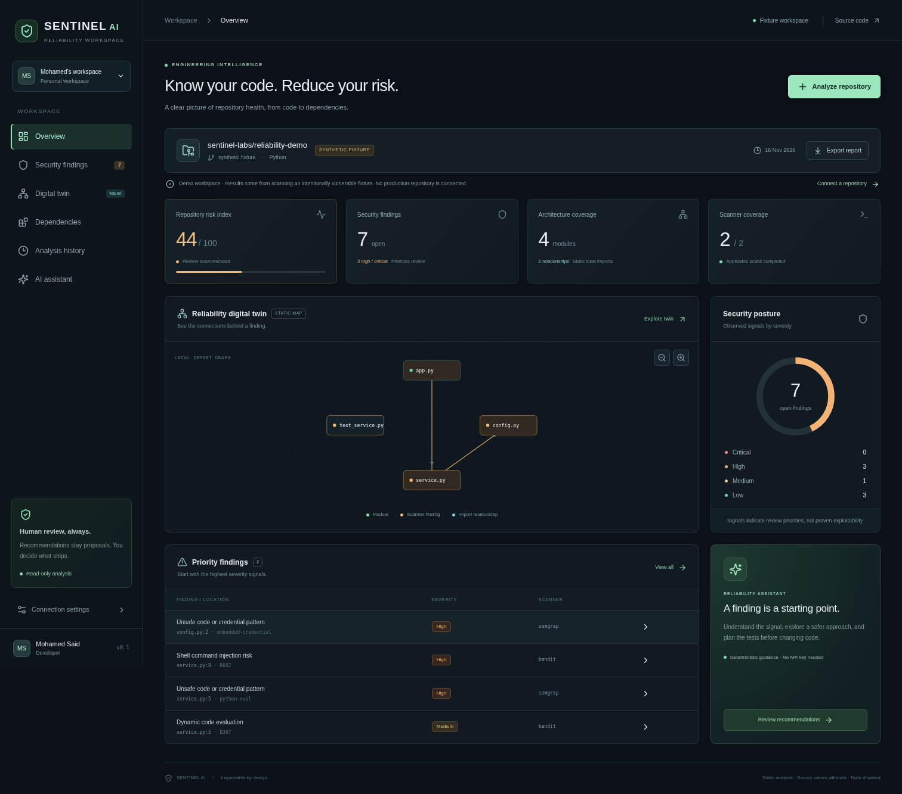
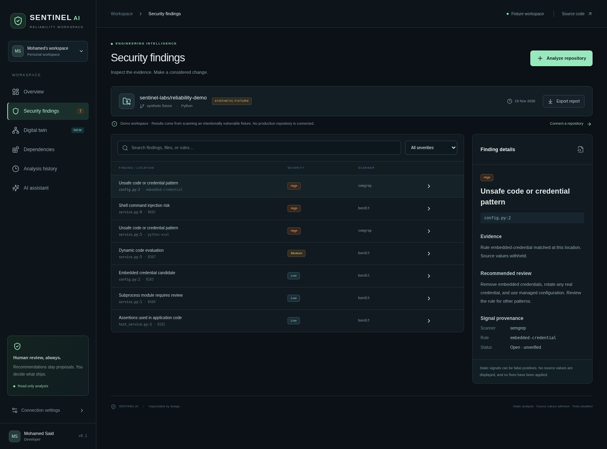
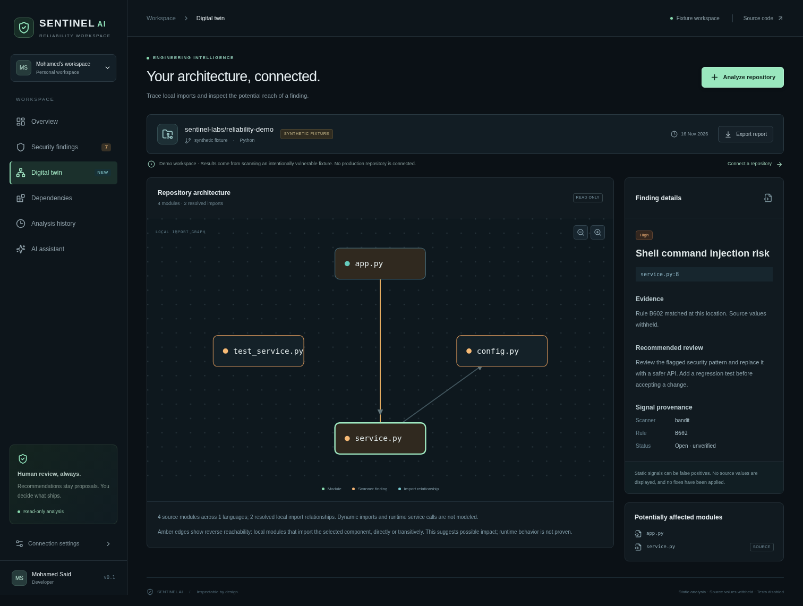
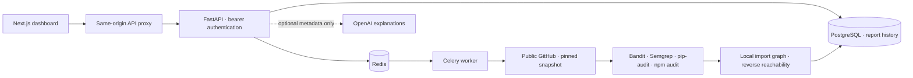

# SENTINEL AI
### Autonomous Software Reliability Engineer — human-reviewed analysis

A software reliability workbench that imports public GitHub snapshots, runs established scanners, and connects findings to an inspectable local-import graph. Built by [Mohamed Said](https://github.com/mohamedbreed192-droid) as a portfolio engineering project.

**Next.js · TypeScript · Tailwind CSS · FastAPI · PostgreSQL · SQLAlchemy · Redis · Celery**



## What works

- Public GitHub URL validation, public-metadata verification, commit-pinned and size-bounded archive import. No Git hooks, package installation, or repository code execution.
- Real **Bandit**, **Semgrep**, **pip-audit**, and **npm audit** adapters with normalized severity, location, source-free evidence, remediation, and explicit coverage status. A failed or missing scanner never counts as a clean scan.
- Persistent analysis jobs, asynchronous Celery workers, bounded queue admission, history, risk comparisons, and Markdown report downloads.
- **Reliability digital twin:** Python AST and relative JavaScript/TypeScript import resolution, clickable modules, reverse reachability, and finding impact highlights. This is a static import model, not an observed runtime dependency map.
- Deterministic explanations without a provider key. Optional OpenAI explanations send only normalized rule metadata, never repository source. Narrow `eval(name)` patch proposals include zero-context diffs and test suggestions. All proposals remain unverified.
- Responsive dashboard with searchable/filterable findings, coverage, structure, history, and a review workspace.
- Explicitly enabled, offline Docker test runner. The API never receives the Docker socket and cannot start repository tests.

The word “autonomous” describes the analysis workflow. The system does **not** automatically apply changes, open PRs, merge, or deploy. Draft PR integration is deliberately not implemented; any future integration must require explicit approval.

## Start locally

Requirements: Docker Engine with Compose v2, 4 GB available RAM, outbound access to GitHub/PyPI/npm for live analysis.

```bash
cp .env.example .env
# Edit .env: choose random POSTGRES_PASSWORD and API_TOKEN.
# Use the same URL-safe password in DATABASE_URL. Never commit this file.
docker compose up --build -d
```

Open **http://localhost:3000**. The initial workspace loads the bundled fixture; it makes no backend requests until you connect a repository. Select **Analyze repository**, enter a public GitHub URL and your `.env` API token. The token stays in browser memory. API docs: **http://localhost:8001/docs**. Complete job metadata/report access requires bearer authentication.

Services bind to loopback. This is a **single-owner local deployment**, not an internet-ready multi-tenant service. Add TLS, user authentication, authorization, tenant isolation, durable queue operations, and an external containment boundary before exposing it. See [security model](docs/SECURITY.md).

```bash
docker compose ps
docker compose logs --tail=40 worker
# Stop services, retaining the PostgreSQL volume:
docker compose down
```

### Development without Docker

Python 3.12, Node 22, and Linux are supported. A local SQLite database is available for development; production-shaped Compose uses PostgreSQL and Alembic.

```bash
python3.12 -m venv .venv
. .venv/bin/activate
pip install -r backend/requirements.lock
export PYTHONPATH="$PWD/backend"
export API_TOKEN="your-random-development-token"
export SYNC_JOBS=true
python scripts/generate_demo.py
cd backend
uvicorn sentinel.main:app --port 8001
```

In another terminal:

```bash
cd frontend
npm ci
npm run dev
```

`SYNC_JOBS=true` is a convenience for local development only: imports block the request. Compose leaves it false and uses Redis/Celery. Do not enable this setting for exposed services.

## Screenshots

Screenshots are captured from the running application by Playwright. Results shown are produced by real scans of `fixtures/demo`, an intentionally vulnerable synthetic project. They are not evidence of production findings or verified fixes.

| Security evidence | Reliability digital twin |
| --- | --- |
|  |  |

[Assistant and proposed patch](docs/screenshots/assistant.png) · [Mobile dashboard](docs/screenshots/mobile.png)

## Verify

```bash
. .venv/bin/activate
cd backend
PYTHONPATH=. pytest -q
cd ../frontend
npm ci
npm run typecheck
npm run build
npx playwright install chromium
npm run test:e2e
npm audit
```

Playwright starts its own test server on port 3100 and writes screenshots to `docs/screenshots/`. For a system Chromium, set `PLAYWRIGHT_CHROMIUM_EXECUTABLE=/usr/bin/chromium`. For an already-running application, set `PLAYWRIGHT_BASE_URL=http://127.0.0.1:3000`.

Python dependency audit:

```bash
pip-audit -r backend/requirements.lock --no-deps --disable-pip
```

**Known dependency advisories remain in Semgrep's upstream-pinned CLI dependencies.** The full audit is intentionally retained. CI reports these six known advisories and fails for newly introduced advisories using a documented baseline. This is not a clean dependency bill of health. [Details and containment](docs/DEPENDENCIES.md).

## Explicitly isolated tests

The analysis pipeline never executes repository tests. An operator can separately opt in:

```bash
docker build -f scripts/test-sandbox.Dockerfile -t sentinel-test-sandbox:local .
python scripts/run_isolated_tests.py /absolute/repository --enable-untrusted-tests
```

This uses an unprivileged container, read-only repository, no network, no capabilities, bounded memory/CPU/PIDs, bounded temporary storage, a timeout, and no repository dependency installation. Only projects compatible with preinstalled pytest can run. Docker is a mitigation, not a perfect boundary for hostile native code; use a disposable VM or stronger sandbox for adversarial repositories. Results are operator-side and are not attached to an analysis or used to claim a patch is verified.

## Architecture and engineering decisions

[Architecture & tradeoffs](docs/ARCHITECTURE.md) · [Security model](docs/SECURITY.md) · [Verification record](docs/VERIFICATION.md) · [Dependency advisories](docs/DEPENDENCIES.md)



## Scope and limitations

This is a tested engineering baseline, not a security certification. The bundled Semgrep rules cover only three pattern families; Bandit only supports Python. pip-audit accepts exact pins in `requirements*.txt` and deliberately refuses arbitrary requirements options, URLs, and installers. npm audit uses lock metadata without running install scripts. No lockfile means no npm dependency result. Advisory severities are normalized review priorities, and Python advisories default to high rather than claiming CVSS precision.

The risk index caps a weighted sum at 100: critical 25, high 12, medium 5, low 1. Findings can overlap between scanners; the index is neither a probability nor a validated reliability score. History contains only stored runs. Scanner coverage can differ, so risk changes are not automatically improvements. No fabricated time series is included.

LLM integration is optional and tested through local doubles only; a live provider call has not been verified. Model output may be wrong. Patch generation is limited to simple Python `eval(identifier)` expressions, exports no surrounding context, and may change semantics. Proposed tests are review suggestions, not executed validation.

No external container hosting account was configured. GitHub publication contains source, screenshots, CI, and deployment instructions; it does not imply a public running backend.

## License

[MIT](LICENSE). Third-party tools retain their own licenses. The bundled fixtures contain synthetic values only.
